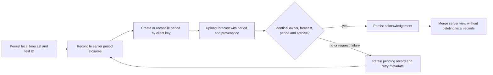

# Priority 3 security and integrity remediation

Base: `d450e3fdf8485558906a42142882fc50f7f686af`. Dedicated branch: `remediation/priority3-integrity`. Review status only; **not a production-readiness assessment**. The target checkout was clean at the audited commit. No unrelated repository or pre-existing working change was modified.

The standalone audit report was not present in the checkout. The five issue classes below map the supplied remediation brief to reproduced code paths; they do not invent additional audit IDs or severity ratings.

## Root causes and remedies

| Issue | Root cause at audited commit | Remedy and evidence |
| --- | --- | --- |
| 1. Hindsight forecasts counted as forward tests | The insert trigger stamped a lock time but did not compare it with any session deadline. Late predictions were immediately scored against existing results, and aggregates included every scored row. | Database-owned receipt time, exclusive session-open deadline, dated exchange-timezone calendar, immutable eligibility and import provenance. Missing calendars fail closed. Verified-only statistics and opt-in ranking; historical grades/history remain accessible. PostgreSQL tests reproduce the original historical ranking, preserve its underlying records, then prove their exclusion and a positive verified-ranking control. |
| 2. Browser loss and period misassociation | `lock-fix.js` replaced the app's lock handler and omitted period/acknowledgement IDs. Closure was fire-and-forget. HTTP 400/409 could finish migration; login replaced entire arrays; stale writes and display deduplication discarded variants. | One durable lock path, persistent per-record retries, period client keys, closure-before-replacement ordering, owner/period/value/archive equality on acknowledgements, non-destructive merges and no display-driven deletion. Preserve profiles on logout. Real served-page tests include the compatibility override, offline/reload recovery, interrupted closure, one-session completion, scheduled 365-session tests and manual scoring. |
| 3. Malformed identities and signing-key rotation | JWT parsing assumed `.get()` existed on decoded JSON. Numeric types/lifetimes were loosely handled; a cached JWKS could not resolve a newly rotated key. | Strict objects/base64/claim types, finite timestamps, bounded lifetime and RSA parameters, safe authorization errors, one cooldown-bounded refresh on unknown `kid`. Invalid identities never call collection. Rotation, malformed keys, network failures and refresh-flood bounds have regression tests. |
| 4. Token reuse and unbounded collector destinations | One short-lived OIDC token was reused for up to ten 180s batches. Any HTTPS destination, including redirects, could receive it. | Fresh identity immediately before each batch; exact approved HTTPS host, port and path; no userinfo/query/fragment/redirect. Execute the actual workflow Python in tests with local mocked HTTP, including two distinct identities. Cron, enable-variable gate, permissions and concurrency configuration remain unchanged. |
| 5. Internally inconsistent market data | Normalization checked intraday containment/open but not equality of daily extrema and final close. A materially different daily close could change grading without being rejected. | Versioned decimal tolerance for first open, maximum high, minimum low and last close. Daily remains authoritative only inside tolerance. Repeat checks at the publication RPC. Atomically quarantine inconsistencies with private raw audit and lease protection; no publication or scoring occurs. Existing canonical sessions remain immutable/idempotent. |

The deadline and reconciliation policies were documented before their implementations in [REMEDIATION_POLICY.md](../REMEDIATION_POLICY.md).

## Schema and data preservation

**Only new migration: `supabase_phase3_remediation.sql`, after Phase 3.** Original Phase 1/2/3 SQL files are unchanged. The migration is transactional and repeatable; it is not executed by application startup, tests against live services, or this remediation task.

- `forecast_sessions`: private, dated, service-role-provisioned open/holiday windows, exchange timezone, first recording time and source reference. The insert trigger validates dates/timezones. Calendar RPCs cannot be called by normal users. When existing server credentials are configured, a forecast request may populate a missing window from dated provider calendar endpoints; this does not start collection or fetch price candles. Without prerequisites it retains the prediction unverified.
- `predictions`: additive `submission_kind`, `verification_status`, `server_received_at`, `eligibility_deadline`, and private `import_metadata`. Existing rows retain all forecast and score values and become conservatively `legacy_unverified`. Existing scores, score timestamps, IDs and rule versions are not recalculated. Client insert grants do not include eligibility/deadline/receipt/score fields; the trigger stamps these itself.
- `import_metadata` archives original local score, actual result, lock time and client ID for new historical imports. It is immutable and owner-private, not an input to eligibility or authoritative scoring. Browser caches preserve `originalLocalScore` separately from `serverScore`; importing or hydrating a historical grade does not erase the user's original manual grade.
- `test_periods.client_key` and per-user partial unique index support idempotent creation. Existing periods, start dates and 1–365 targets stay intact. The browser preserves IDs and uses the exchange day for closure, including the IST midnight boundary; scheduled tests are not mistaken for active-day tests.
- `market_data_quarantine` and a `quarantined` job state preserve rejected raw data privately. Quarantine and attempt recording are atomic and reject stale leases. Quarantined jobs are not automatically claimed; existing administrator retry can explicitly requeue them while preserving audit history.
- The original publication implementation remains private as `publish_market_session_unchecked`; no normal user or service-role caller can invoke it directly. The public service-role publication entry point now enforces raw-candle reconciliation before using the original atomic insertion/scoring path. Duplicate existing sessions use the original idempotent catch-up path and cannot overwrite outcomes.

There are no data-deleting statements and no changes to scoring weights or `p2-v1`. Changing verified aggregate membership is intentional: preserving a historical score is different from certifying its forward-test timing. The 1–365 UI, styling, forms and local/manual fallback remain; provenance labels clarify unverified history. Asset/cache versions are updated so an old compatibility script cannot silently restore the broken lock implementation.

## Synchronization contract



Requests are bound to the expected authenticated user, including an account switch while waiting for a session token. Retry metadata is stored with predictions/periods, survives reload and is retried on sign-in, online events and a 30s timer with bounded backoff. A response racing a local closure cannot mark that closure synced or undo it. No new record is acknowledged from an incomplete representation. HTTP 409 requires matching the existing record, including original archive data for imports; conflicts remain pending rather than overwrite locked server data or discard local variants.

## Validation results

Commands run from the repository root using only isolated/local fixtures:

| Command / suite | Result |
| --- | --- |
| `python3 -m unittest discover -v` | 56 passed, including all 39 pre-existing Python/security/HTTP tests |
| `npm ci --prefix tests --ignore-scripts` | Passed; existing pinned PGlite dependency |
| `npm test --prefix tests` — original PostgreSQL suite | 12 passed |
| Same command — new remediation PostgreSQL suite | 12 passed |
| Same command — JavaScript synchronization tests | 14 passed |
| `python -m unittest tests.browser_integration -v` in browser-test venv | 6 passed in system Chromium; served HTML, real scripts and mocked same-origin APIs |
| `python3 -m compileall -q server.py backend tests` | Passed |
| `node --check` for every root/service JavaScript file | Passed |
| `git diff --check` | Passed |

One old normalization test's fixture deliberately differed by a full point between daily and last intraday close. That acceptance is the defect under remediation. Its assertion that the daily close remains authoritative is preserved with a within-tolerance fixture; separate Python and PostgreSQL regressions reject material mismatches and cover the exact 0.05-point boundary. No assertion was disabled.

The original service-role isolation test remains intact: secret material is read only by the isolated privileged repository client and existing account-deletion path. Calendar services receive only a readiness boolean and named RPC capabilities, never the service-role credential.

PGlite executes real PostgreSQL SQL, roles, grants and RLS in WASM with stand-in Auth roles. It is not a live Supabase/PostgREST test or a multi-connection concurrency stress test. Browser tests use fake Supabase identities and same-origin API fixtures and block external requests; they do not create accounts, use production data, or contact a live broker. Synthetic future outcomes in the ranking positive control isolate aggregation; the canonical publication tests separately reject invalid/future outcomes. Tests never enable a real collector.

Browser-test setup (Chromium must already be installed; no account or broker token needed):

```sh
python3 -m venv /tmp/mft-browser-tests
/tmp/mft-browser-tests/bin/pip install -r tests/requirements-browser.txt
MFT_TEST_CHROMIUM=/usr/bin/chromium /tmp/mft-browser-tests/bin/python -m unittest tests.browser_integration -v
```

Use your installed Chrome/Chromium executable on another platform. The local/manual test also disables `crypto.randomUUID` to exercise the HTTP/LAN-compatible idempotency-ID fallback.

## Remaining limitations and required staging coverage

Follow [STAGING_VALIDATION.md](STAGING_VALIDATION.md) under separate authorization. No production-readiness claim is made from local results.

- Confirm actual Supabase grants, Auth claims, PostgREST row representations, HTTP errors and migration time/locking on a staging copy. Large-table migration duration and concurrent multi-connection behavior are not established by WASM tests.
- Verify live dated provider calendars, special sessions, entitlements, publication delay, tolerance suitability and token expiry with authorized fixtures. A missing/unavailable calendar deliberately yields unverified history; a late calendar never retroactively promotes records.
- Confirm real GitHub OIDC issuer/JWKS rotation, runner token lifetimes and exact staging destination authorization. The allowlist currently includes only the existing approved Render hostname; a staging hostname requires a separate reviewed source change, not arbitrary configuration.
- Irreconcilable immutable forecast or archive conflicts remain pending for owner/operator review. This release does not overwrite a conflicting server forecast. Existing records deleted by the older release before this remediation cannot be reconstructed from missing data; current local stores must be backed up before any future rollout.
- Provider credential renewal remains an operator operation in the approved secret store. Existing 401/403 cooldown/retry behavior remains; no login/OAuth or secret rotation was attempted here. Workflow identity tokens are renewed automatically per batch.

## Backward compatibility and rollback

Keep collection and scheduling disabled during review. No production Supabase, Render or Actions settings have been changed. `render.yaml` and original migrations are unchanged; the workflow's existing enable gate is retained.

Apply the new migration only after reviewing a staging backup and Phase 3 baseline. New API statistics depend on the new columns, so database-before-application order is required. An older browser remains unable to backdate server receipt or write verification/score columns, but only the new browser carries full import archives and durable acknowledgements; force asset/cache refresh during an eventual authorized rollout.

Prefer a forward fix. Retain all new tables, columns, archives and audit records during application rollback; do not drop data, rerun old migrations, restore broad insert grants, expose the unchecked publisher, or restore aggregates that call historical grades verified. Rolling back frontend/auth merge code would reintroduce data-loss paths, so retain those safeguards. If a new collector implementation fails in staging, keep collection disabled rather than restore an unchecked publisher. Restoring a live backup, changing flags, resuming jobs, correcting an old canonical result or promoting historical records requires a separately reviewed operation. There is no automatic downgrade or backfill-to-verified path.

## Complete changed-file list

The generated list below is relative to the audited commit; test artifacts and virtual environments are not committed.

- `.github/workflows/market-collection.yml`
- `PRIORITY3.md`
- `README.md`
- `REMEDIATION_POLICY.md`
- `app.js`
- `auth-v3.js`
- `auth-v4.js`
- `auto-score.js`
- `backend/market_data/collector.py`
- `backend/market_data/normalize.py`
- `backend/market_data/oidc.py`
- `backend/market_data/repository.py`
- `backend/services/forecast_calendar.py`
- `backend/services/predictions.py`
- `backend/services/statistics.py`
- `backend/services/test_periods.py`
- `docs/REMEDIATION_REVIEW.md`
- `docs/REMEDIATION_TEST_RESULTS.json`
- `docs/STAGING_VALIDATION.md`
- `index.html`
- `lock-fix.js`
- `server.py`
- `services/api-client.js`
- `services/prediction-service.js`
- `services/test-period-service.js`
- `supabase_phase3_remediation.sql`
- `sw.js`
- `tests/browser_integration.py`
- `tests/package.json`
- `tests/remediation-database.mjs`
- `tests/requirements-browser.txt`
- `tests/sync.test.mjs`
- `tests/test_priority2.py`
- `tests/test_priority3.py`
- `tests/test_priority3_http.py`
- `tests/test_remediation.py`
